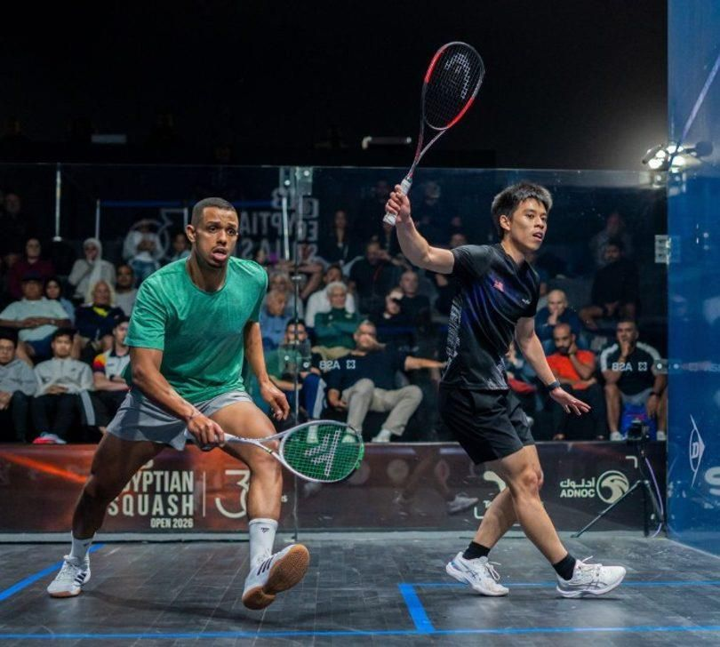

The CIB Egyptian Open was my first PSA Diamond event, the top tier of the tour. I came through qualifying, won my first Diamond-level match 3–0, and then drew the world No. 1, Mostafa Asal.

_✏️ Your story here: what it felt like walking on to that court, the game you won, what you learned from the ones you didn’t._

> I’m sure he’s going to break through and is a future contender for a top ten spot.
> — Mostafa Asal, after our match

_✏️ Add more photos by dropping them in this folder and writing `` on its own line._
