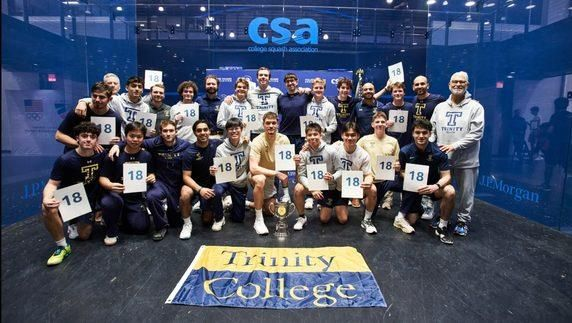

The Skillman Award goes to one senior a year across US men’s college squash, for skill, leadership and sportsmanship over a whole college career. I was the first Malaysian to win it. The same season, our Trinity team went 19–0 and won the national title.

_✏️ Your story here: the team, your coach, what four years at Trinity meant._

> Even in the most pressured moments, Joachim competes with a smile on the court.
> — Moustafa Hamada, Trinity head coach
