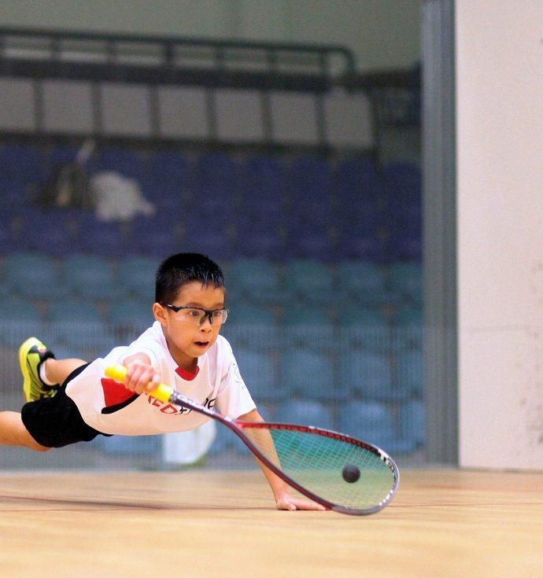

The 2017 Asian Junior Championships were held in Jordan, which made it one of the more interesting trips of my junior years.

What I remember most isn’t really the squash. It’s crossing a bridge that felt genuinely dangerous, and eating Subway almost every single day.

Winning the Under-13 title there meant a lot. But the bigger thing was everything around it: it was the first time my eyes were really opened.

