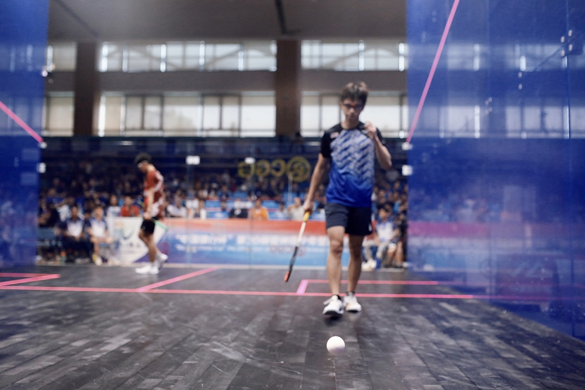
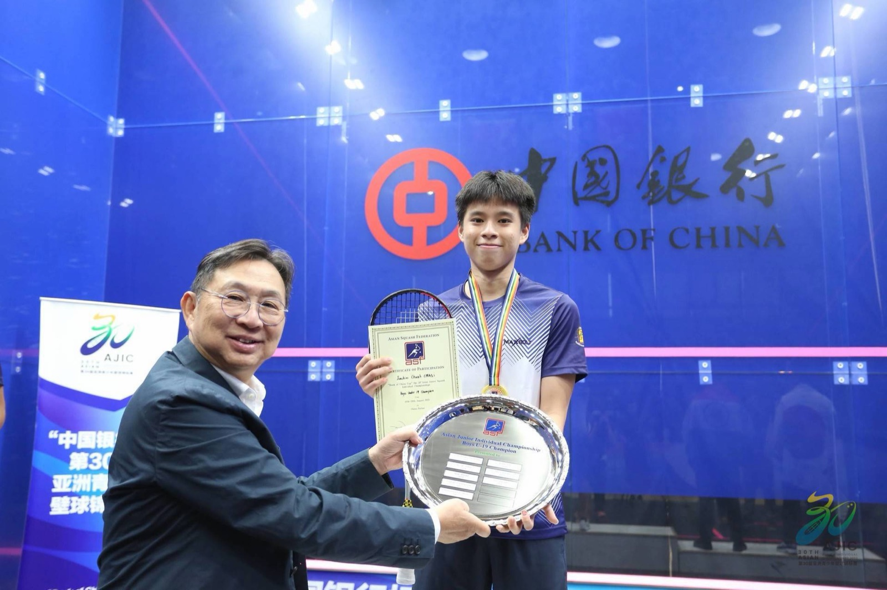

Only a handful of Malaysians have won the Asian Junior title at Under-19. For a junior, it’s about as prestigious as it gets.

This one meant a lot more because I’d lost in the final of the same tournament the year before. And I very nearly lost this final too: I was championship ball down before it turned around.

It came at an interesting time in my life, and it’s one I’ll always hold onto.

Also: I love a good sunset.

