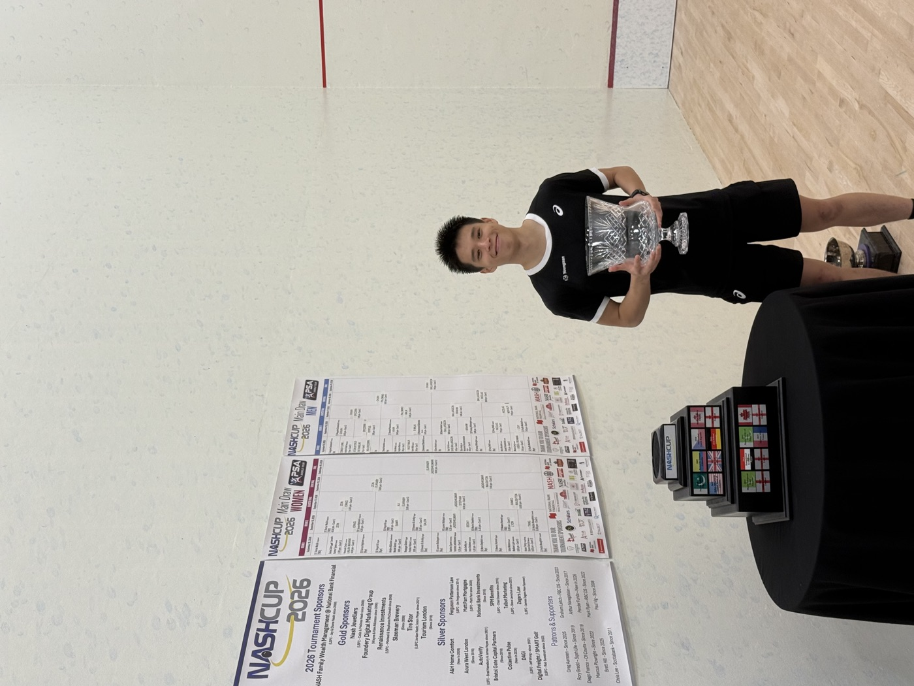
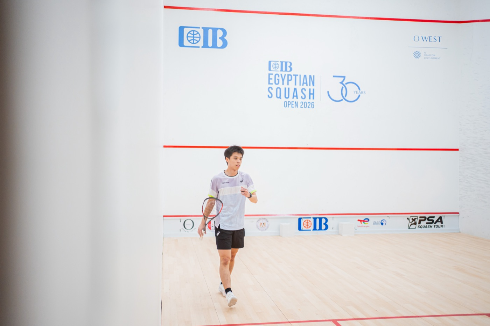
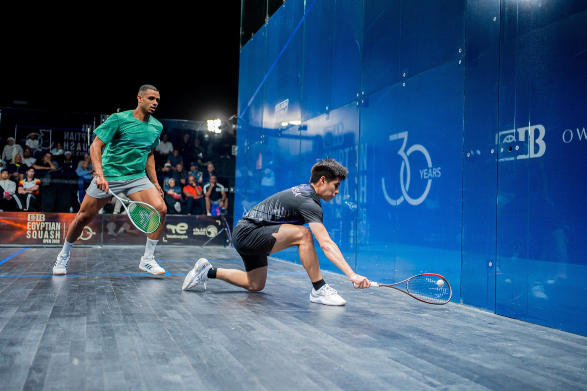
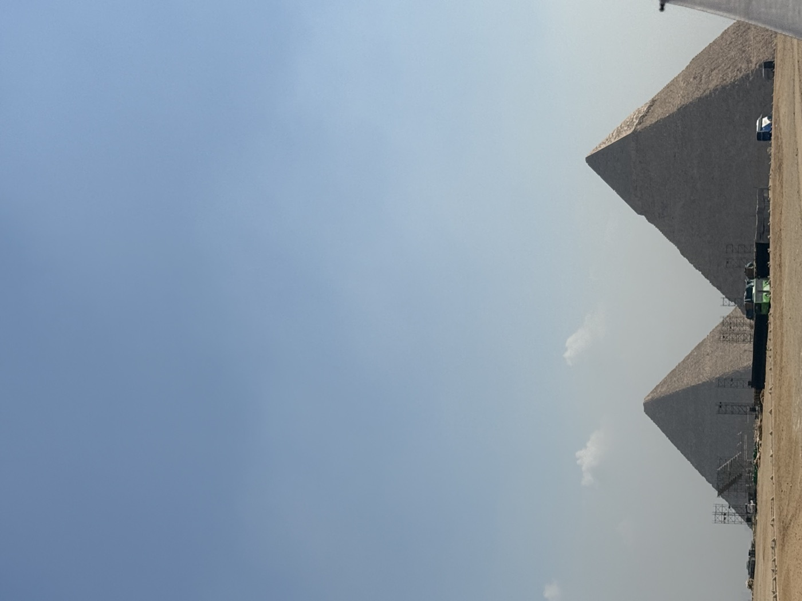
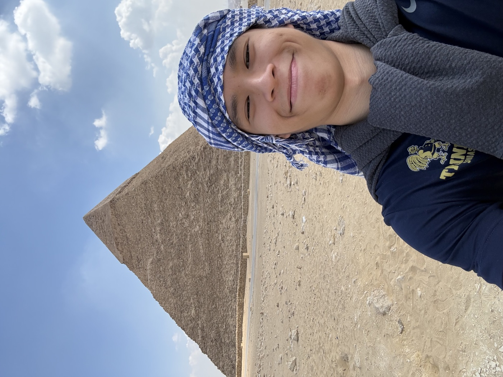
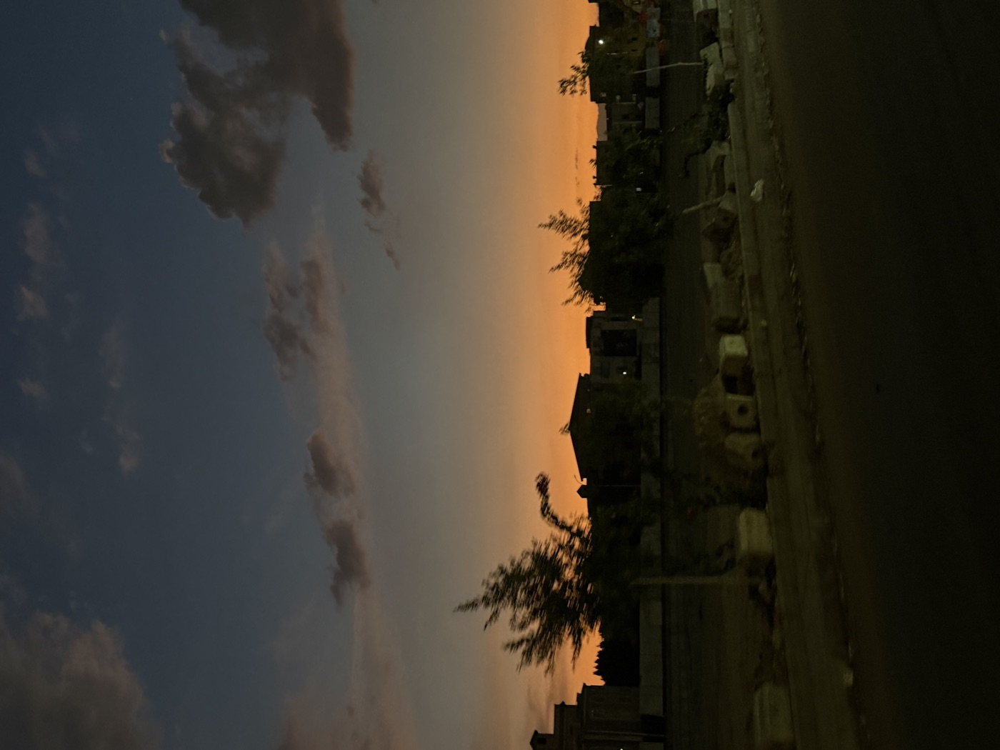

### The NASH Cup

My biggest, and luckiest, title to date.

I came into the NASH Cup off a disappointing start to the season. I was only a month into doing this professionally, and I was already wondering whether I was cut out for it. I started to think I was punching above my weight. You know, the usual doubts you face as an athlete who isn’t performing.

So I went into the tournament with really low hopes. But a moving man eventually meets his luck, I guess. I’m proud of the way I turned things around.

### The Egyptian Open

Two weeks later, I was in Cairo for the first time, at the CIB Egyptian Open, a PSA Diamond event. It was a scary one, because I had to come through qualifying.

I made it through qualifying and even won my first-round match. In the second round, I played the current world No. 1, Mostafa Asal.

What an experience. I even managed to take a game off him. A surreal feeling.

> I’m sure he’s going to break through and is a future contender for a top ten spot.
> — Mostafa Asal, after our match

You know what else is a surreal feeling, though? Seeing the pyramids. So here are some really surreal scenes for ya.

And of course, can’t forget a sunset pic.

