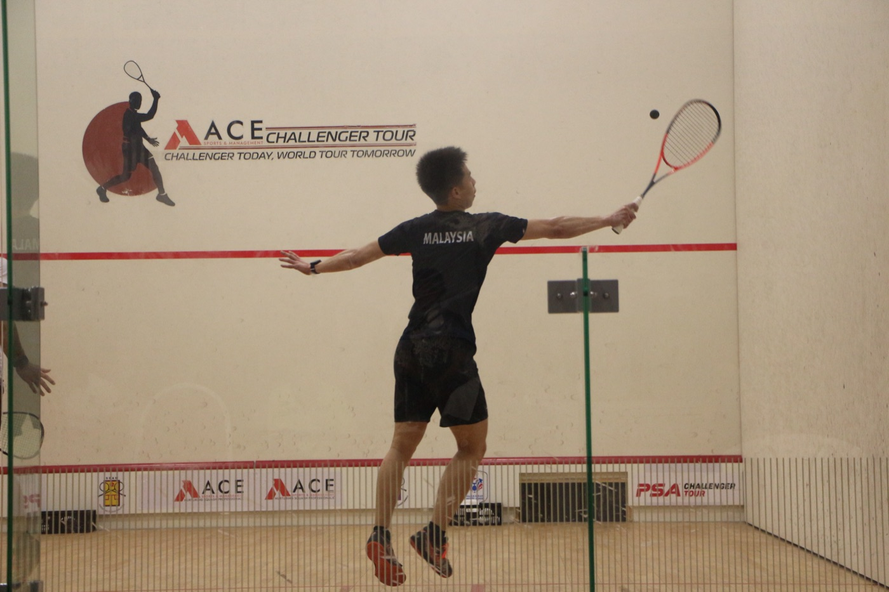
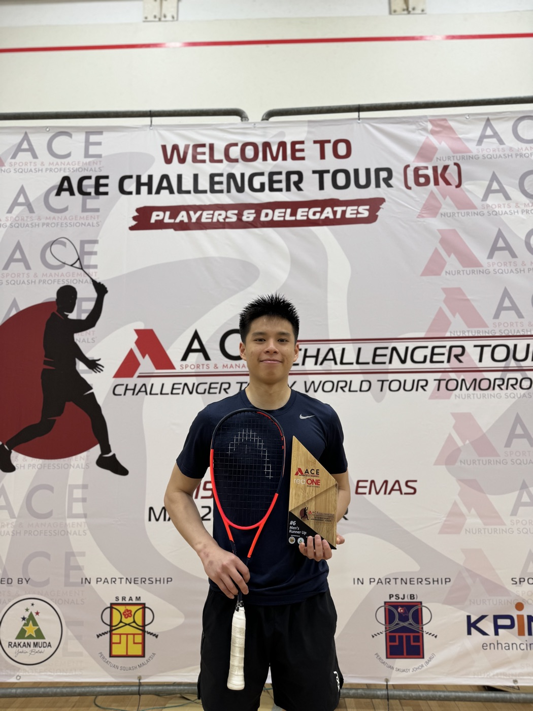
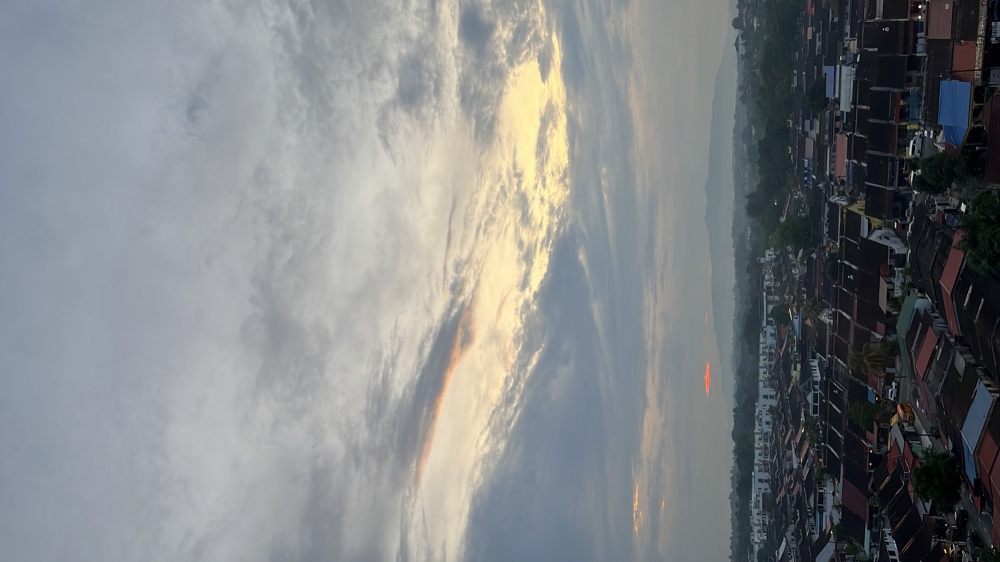
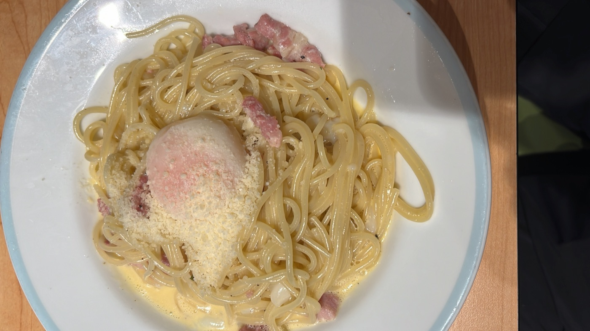
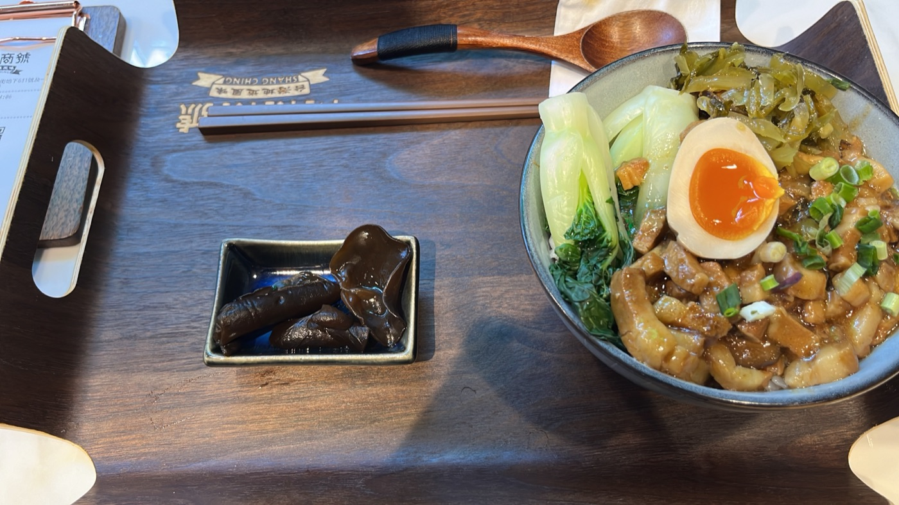
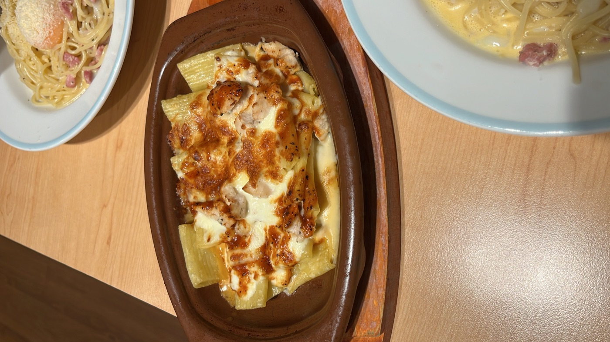
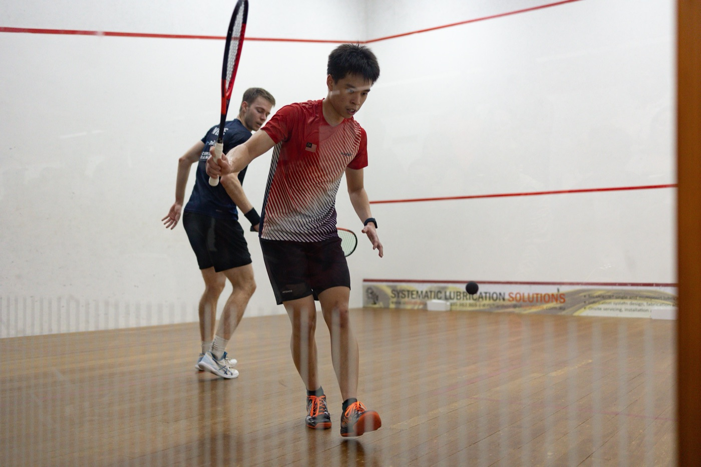
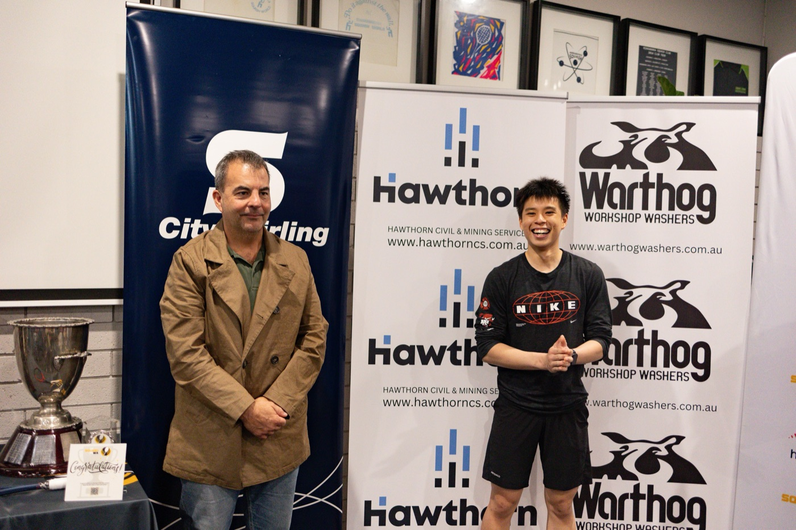
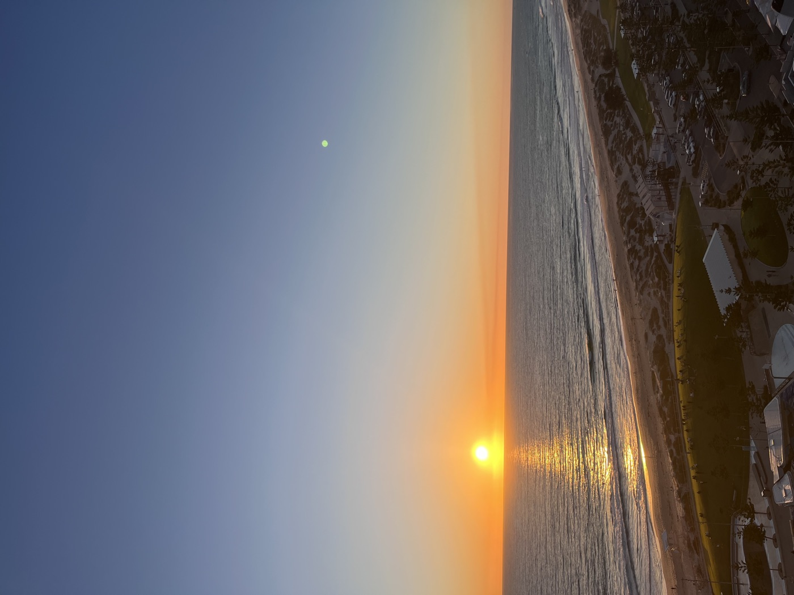

### Malaysia

At this point I had one foot out the door. I still didn’t know what I wanted to do after I graduated, so this was a good test: to see my level against guys who were older and better than me.

It was my first professional Challenger tournament, and I entered as a wildcard. I played my heart out and made it all the way to the final, but unfortunately lost to someone who was miles ahead of me in experience.

I went from 400+ in the world to about 250 in one week. Stayed ten toes down.

Of course, can’t forget a sunset pic.

### Hong Kong

The following week was in Hong Kong. Unfortunately I don’t have any photos of the squash. I played really well, upset some top Asian players, and won my first PSA Challenger title.

Had some really good food too.

### Perth

The week after that was in Perth. I remember it feeling super tough on the body, because I’d already played two tournaments back to back. I was hanging on by a thread.

Good venue, and I loved the people and the amazing hospitality.

I was fortunate enough to win my second Challenger title, and it took me from around 250 to the 150s.

Love a good sunset pic.

Off the back of those three weeks, I was lucky enough to be named PSA Player of the Month.
