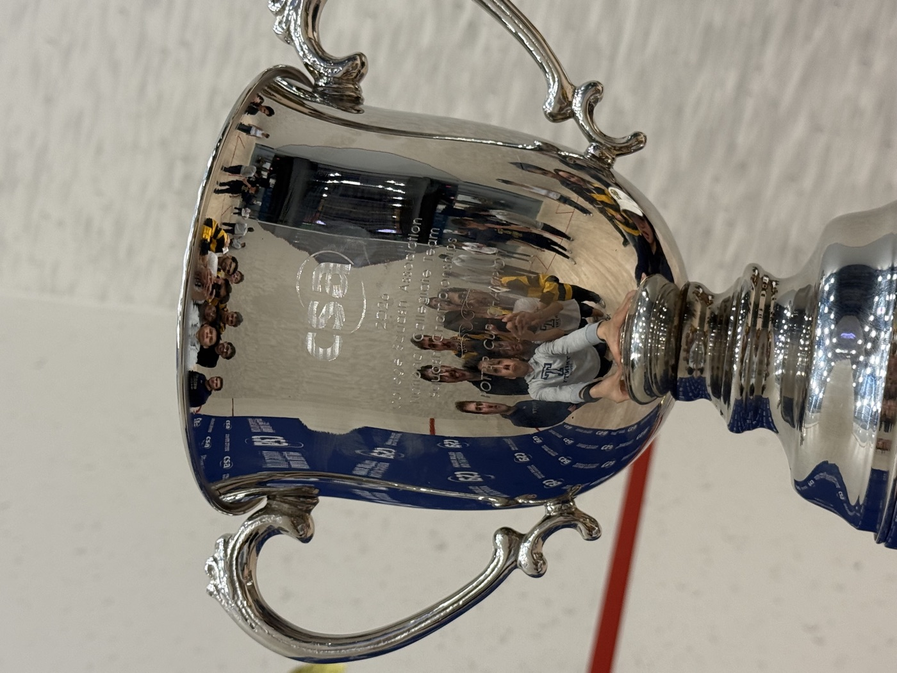
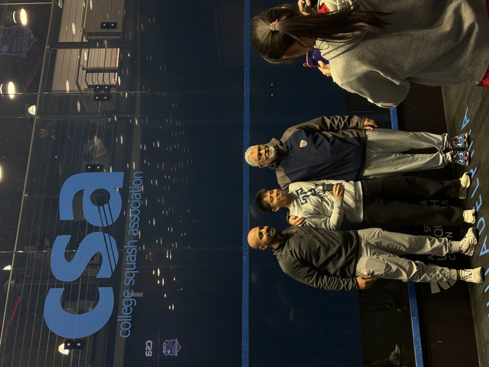
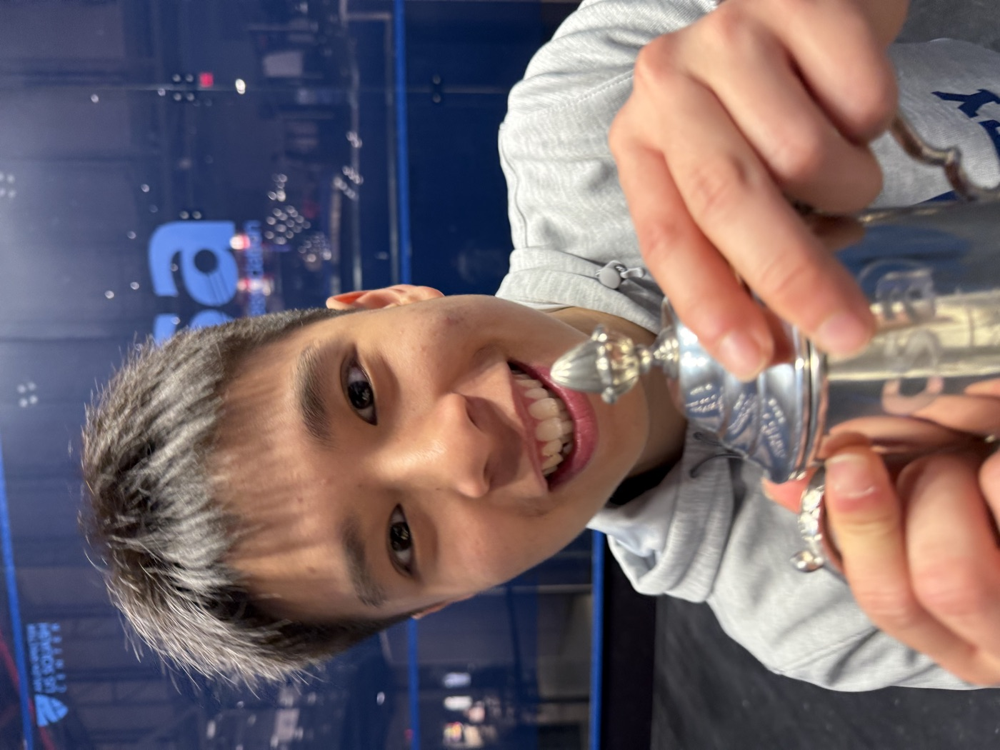
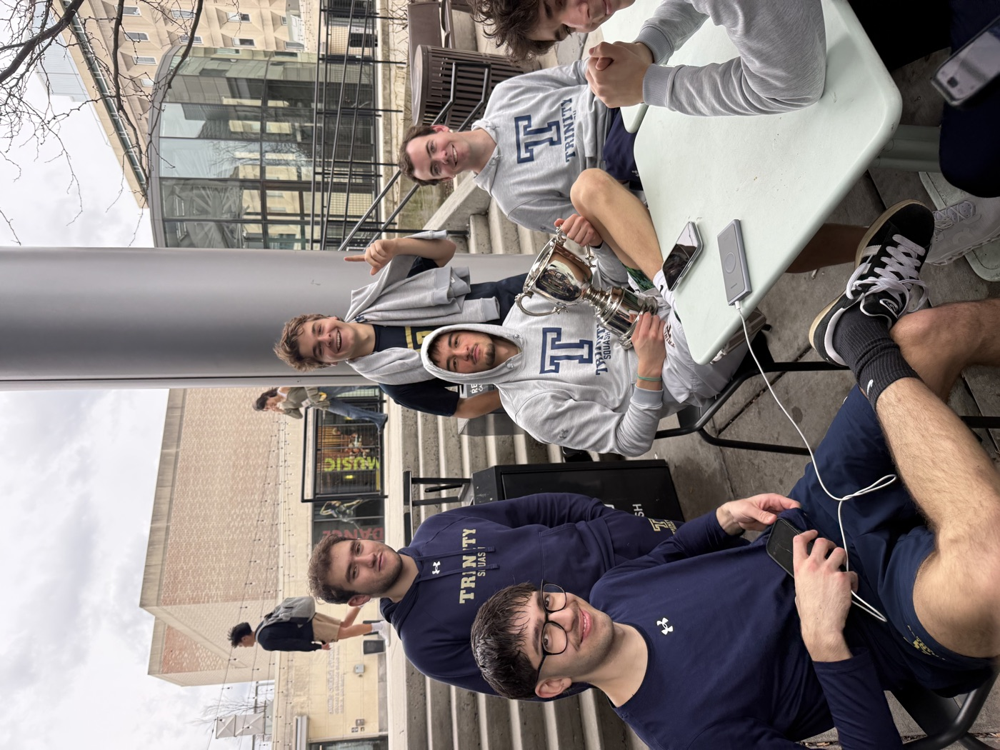
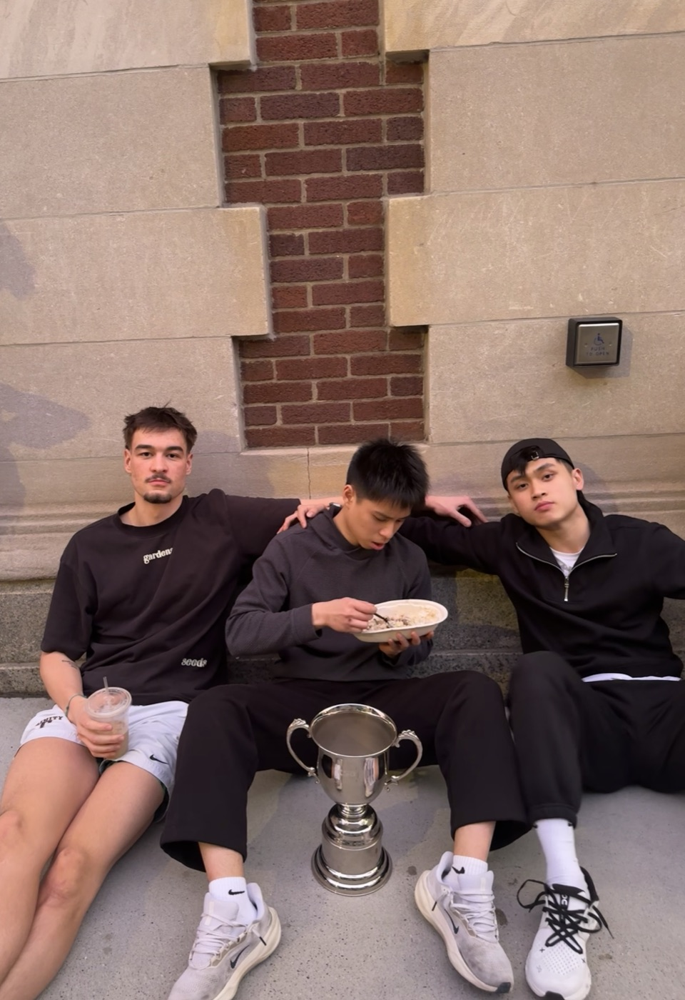
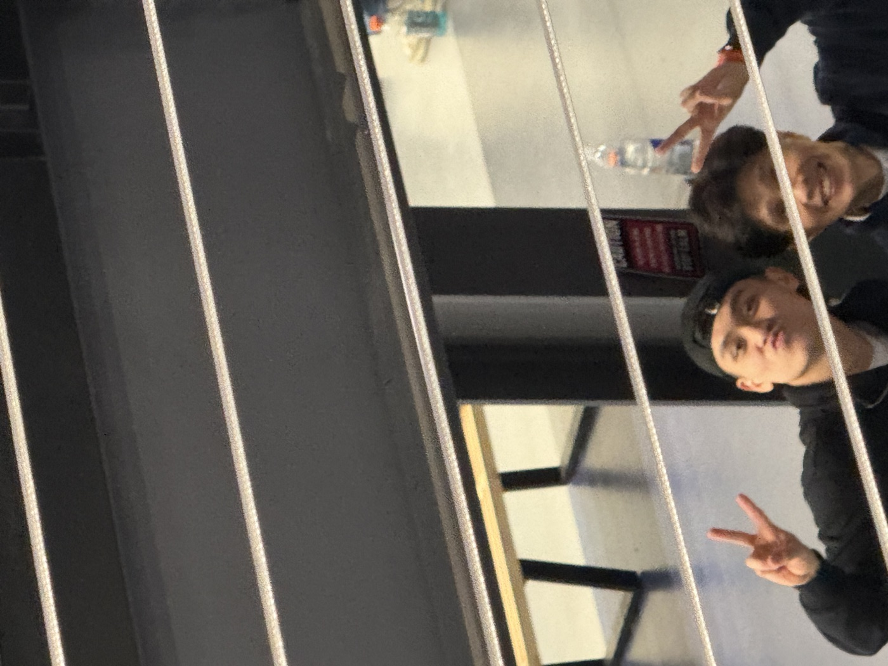

We came into nationals weekend undefeated, so the pressure was all on us.

I’m just grateful I got to share the court with such amazing people.

That same weekend, I won the Skillman Award: college squash’s equivalent of the Heisman Trophy in college football. It goes to one senior a year for their skills, leadership and sportsmanship over a whole college career, and I was the first Malaysian to win it. Having my family there made it even more special.

> Even in the most pressured moments, Joachim competes with a smile on the court.
> — Moustafa Hamada, Trinity head coach

### Champions

Then we won nationals, finishing the season undefeated at 19–0. It was an emotional one. We’d been through three straight years of heartbreak, so this one means the most.

I’m proud to have done it with such amazing people. These friends are my brothers for life. I wouldn’t trade them for the world, and I love them to death.

And of course, a mega pic of Philly.

Possibly the greatest weekend of my life.
