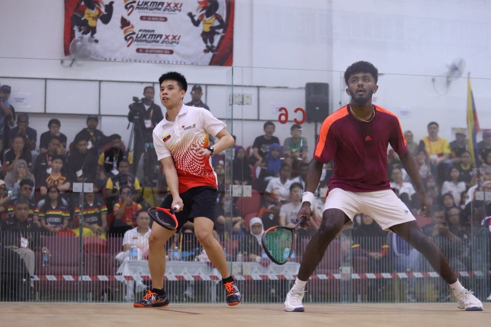
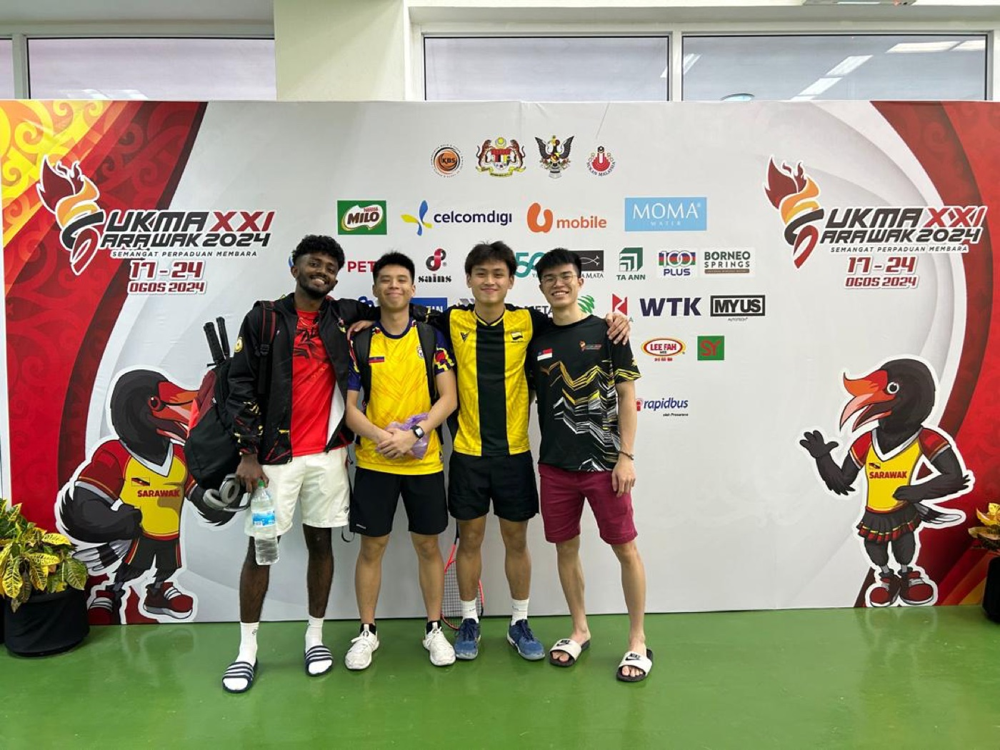
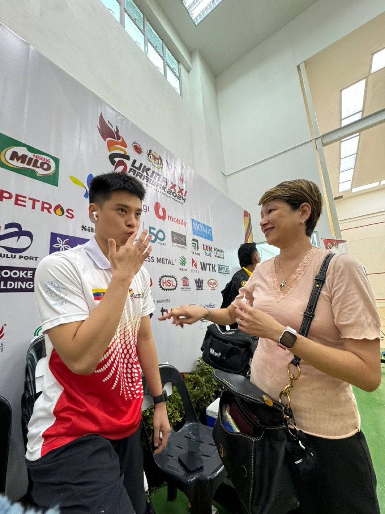
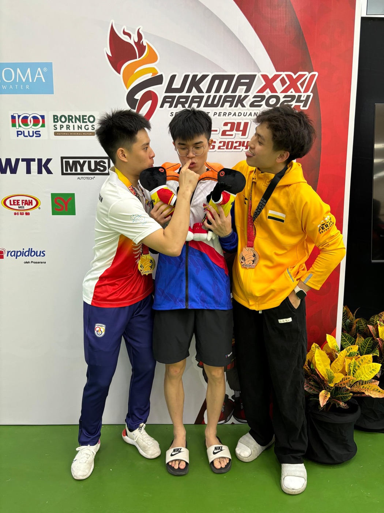
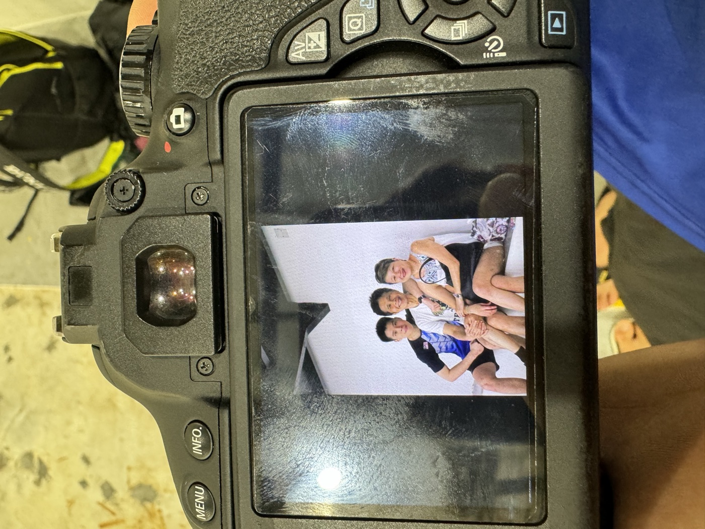
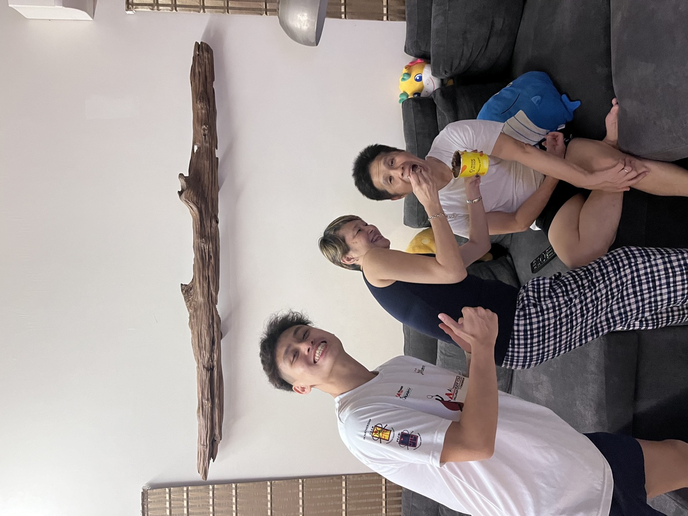
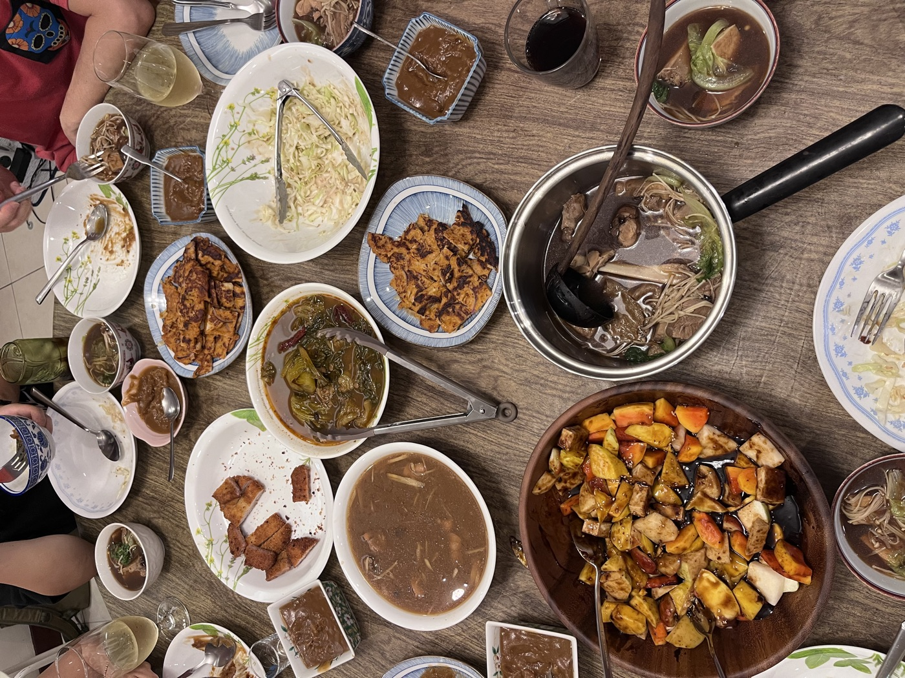
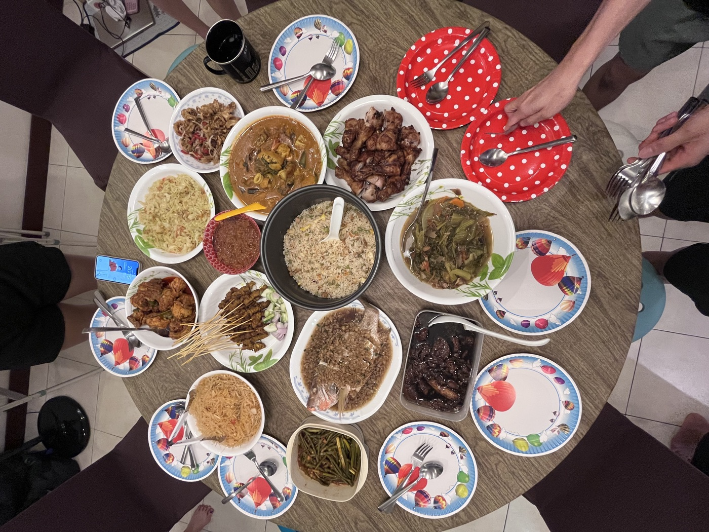

I spent the summer back home, training and playing in Malaysia.

### SUKMA

SUKMA is a major national sporting event in Malaysia, where you compete to represent your state. It’s a rather prestigious one.

I was lucky enough to win the individual event, against a very good friend.

I’m super proud of the way I managed to pull through, and it was even better with family there supporting me.

### Home

Apart from that, I was training hard, spending time at home, having a lot of fun with friends and family, and eating some delicious food.

