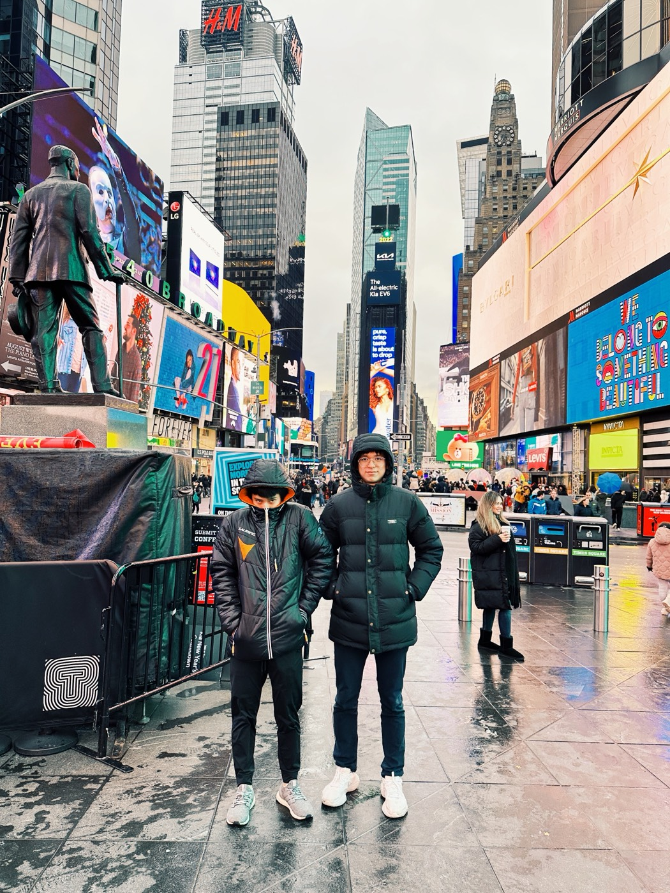
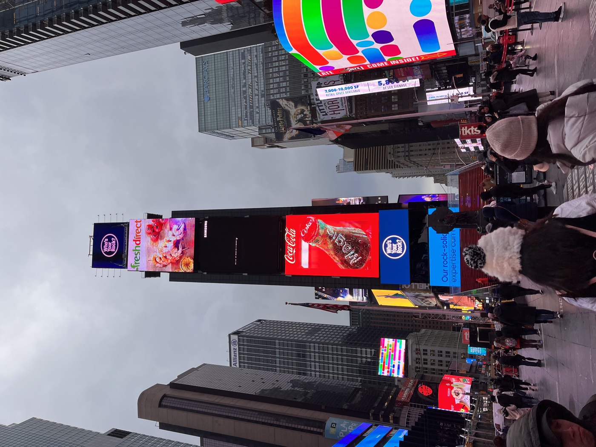
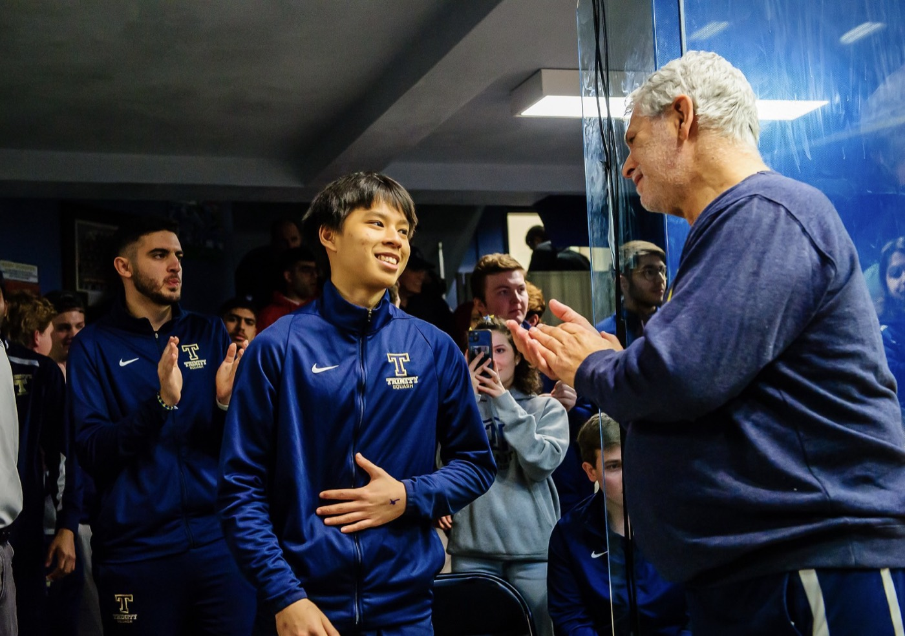
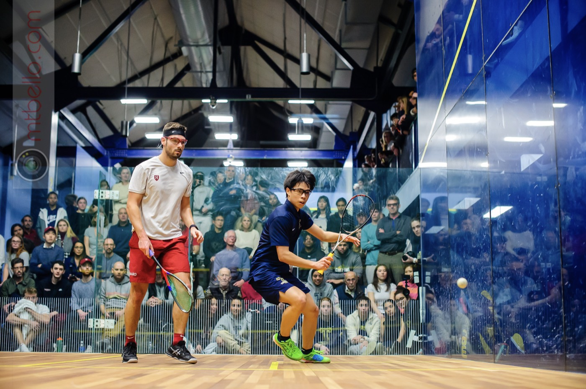
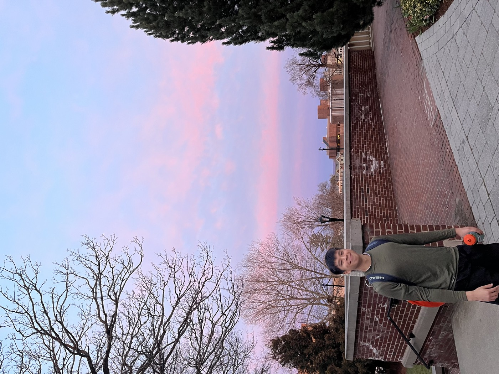

Starting at Trinity College in September 2022 was tough at first. New country, new routine, and a lot to figure out about being a student-athlete: classes, training, matches, and how to fit all of it into one week.

It took time to adapt. But once I settled in, the year opened up things I never expected to see. Trips to New York City, standing at Rockefeller Center, and a lot of other incredible experiences that came from making that move.

### The nationals final

Later that year, our team reached the final of the College Squash Association team championships.

We didn’t win. The team lost 5–4, about as close as a final can get. It was a painful one to swallow, but there were a lot of lessons to learn from it.

And in between, catching more sunsets.

