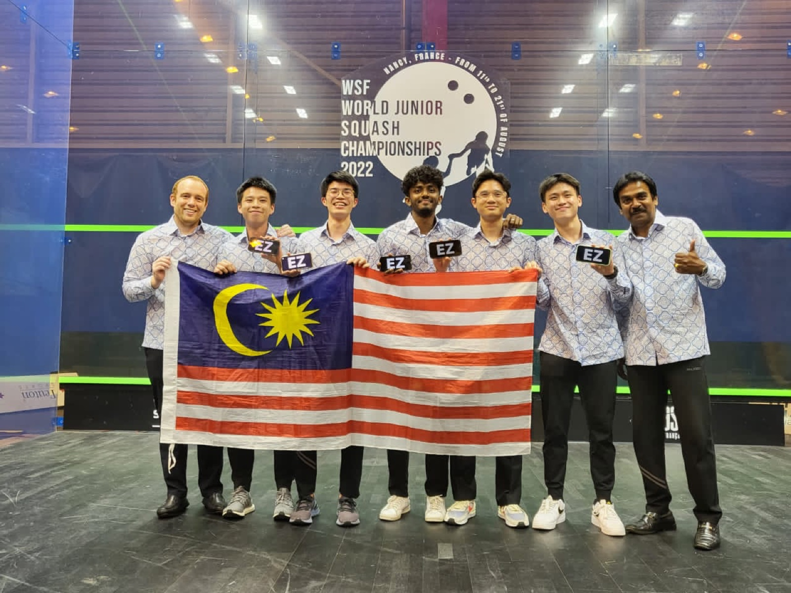
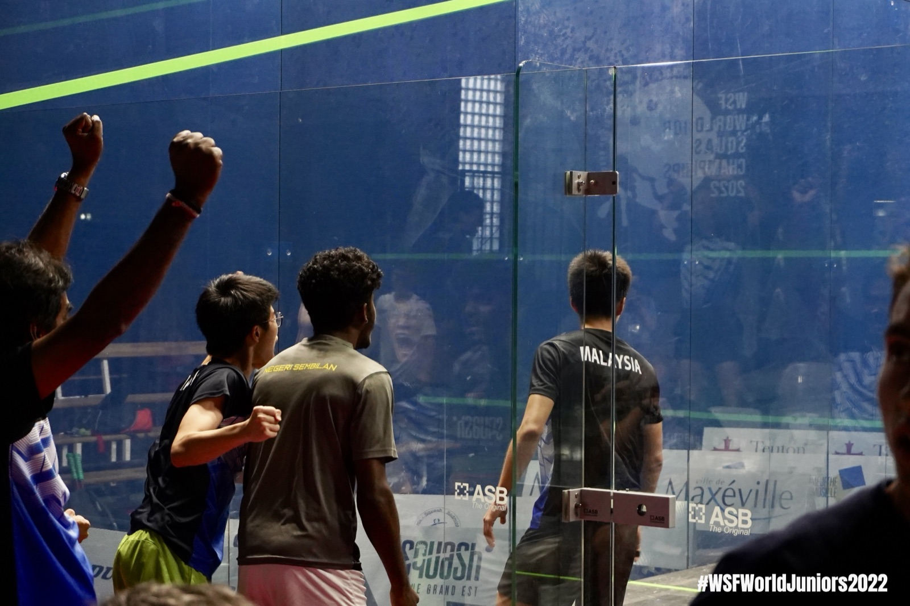
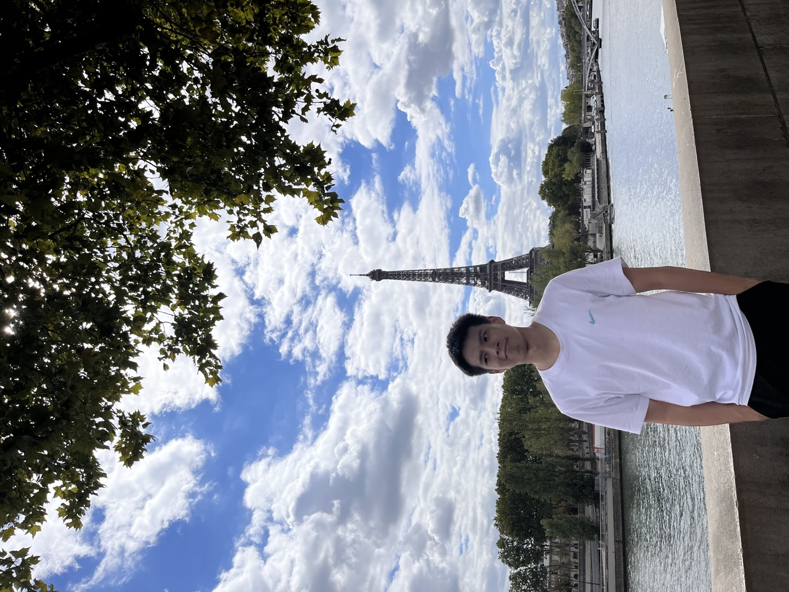

I have so many memories from this one. The 2022 World Junior Championships were in Nancy, France, and I played No. 1 for Malaysia in the team event. We came home with bronze.

It was also the first time I actually thought I could be something in squash.

Life was just as amazing off the court. We explored Nancy together, and most of the downtime was spent running around the city with my teammates. On our last day, we made it to the Eiffel Tower, and had an absolute blast.

